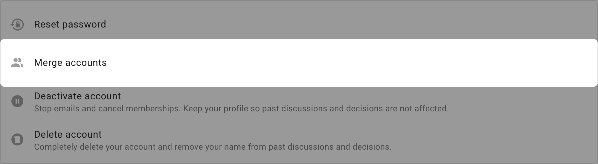
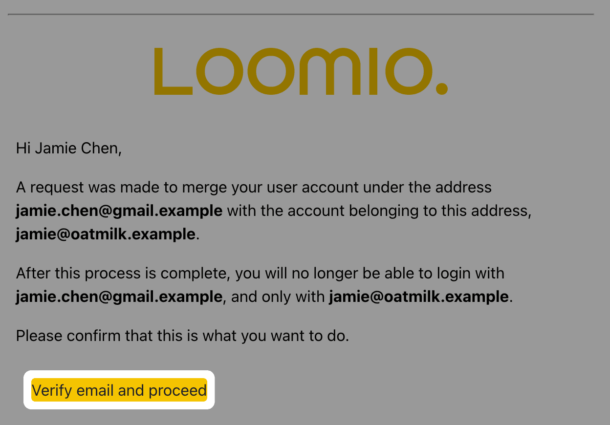
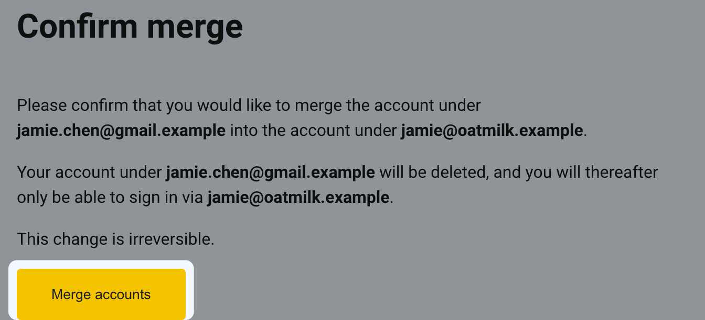

<!-- translation-section: introduction -->

# Merge accounts

Merge two Loomio accounts when each uses a different email address and you want to continue with one account.

Before you begin, decide which account you want to keep:

- The **account to keep** is the account whose email address and profile you will use after the merge.
- The **account to retire** is the account you sign in to first. Its email address will no longer work for signing in after the merge.

You need access to both accounts and to the email address of the account to keep.

> [!WARNING]
> Merging accounts is irreversible. Check the email addresses for the account to retire and the account to keep carefully before confirming the merge.

<!-- translation-section: start-the-merge -->

## Start the merge

1. Sign in to the **account to retire**.
2. Open the sidebar, select your name, and select **Edit profile**.
3. Select **Merge accounts**.

4. Enter the email address of the **account to keep** and select **Send verification email**. For privacy, Loomio always shows the same confirmation and signs you out. If an account uses that address, Loomio sends it a verification email.

<!-- translation-section: verify-the-account-you-want-to-keep -->

## Verify the account you want to keep

5. Open the verification email sent to the **account to keep** and select **Verify email and proceed**.

6. Sign in to the **account to keep** if Loomio asks you to sign in.
7. On the **Confirm merge** page, check both email addresses again. Select **Merge accounts** to complete the merge.

<!-- translation-section: what-happens-after-the-merge -->

## What happens after the merge

After the merge, the account to keep remains your Loomio identity and sign-in account. Loomio moves all group memberships and activity—including discussions, comments, polls, and votes—from the account to retire to the account to keep. If both accounts already belong to the same group, Loomio keeps the membership from the account to keep.

Loomio deletes the account to retire, and its email address can no longer be used to sign in. When the merge finishes, Loomio sends a confirmation email to the account to keep.
