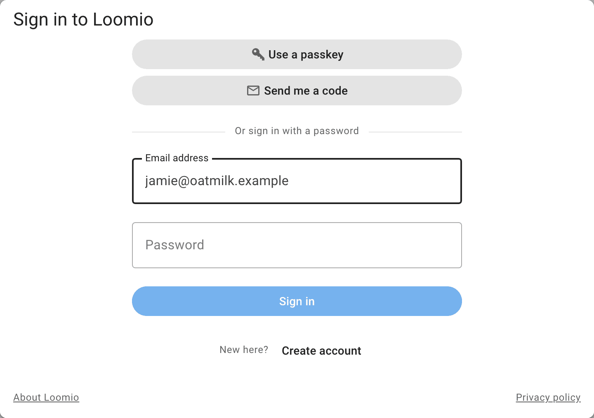
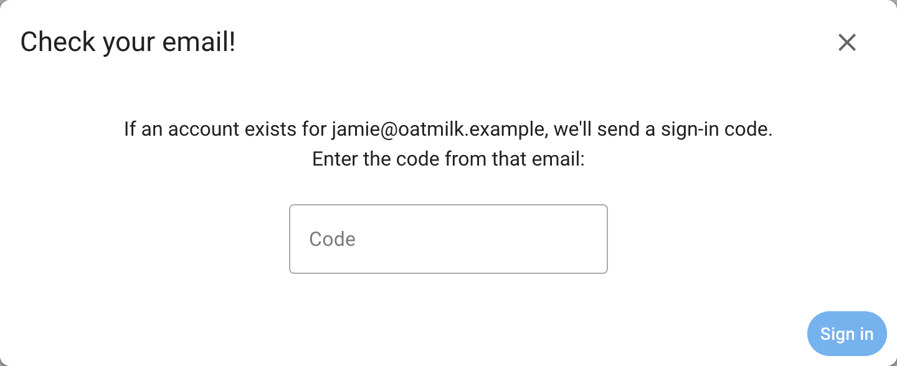

<!-- translation-section: introduction -->

# Signing in

On Loomio.com, you can sign in with a passkey, your email and password, an emailed sign-in code, or Google. Choose whichever method works best for you.

<!-- translation-section: sign-in-with-a-passkey -->

## Sign in with a passkey

Select **Use a passkey**—you do not need to enter an email address first. Your browser or device shows your available Loomio passkeys and asks you to unlock one using your screen lock, fingerprint, face recognition, PIN, or security key.

You can add, name, and remove passkeys from your profile. For security, Loomio may ask you to sign in again before changing them. Give each passkey a clear name such as “Work laptop” or “Phone”. Passkeys belong to the Loomio site where you created them and may sync across devices through your device or password manager.

<!-- translation-section: sign-in-with-email-and-password -->

## Sign in with email and password

Enter your email address and password, then select **Sign in**. For privacy, Loomio shows the same error whether the email address or the password is wrong.

If you have not added a passkey yet, Loomio offers to add one after you sign in. You can dismiss the prompt and Loomio will remember your choice.

If you do not have a password or cannot remember it, select **Send me a code** instead.

<!-- translation-section: get-a-sign-in-code -->

## Get a sign-in code

Select **Send me a code**, enter your email address, and submit the form. For privacy, Loomio shows the same confirmation whether or not the address belongs to an account.

If the address belongs to your account, Loomio emails you a six-digit code. Return to the sign-in form, enter the code, and select **Sign in**. Codes expire after 24 hours and can only be used once. If the email does not arrive, check your spam folder and make sure you entered the address on your account.

After signing in with a code, Loomio offers to set or replace your password, or to add a passkey if your browser supports them. You can skip this and continue using emailed codes.

<!-- translation-section: create-an-account -->

## Create an account

Select **Create account** and follow the email-verification steps.

For privacy, use the same email address that received your group invitation. If you have accounts under more than one address, you can [merge your accounts](/en/user_manual/users/merge_accounts).

<!-- translation-section: sign-in-with-google -->

## Sign in with Google

Select **Sign in with Google** and sign in with your Google account. If an existing Loomio account uses that email address, Loomio links Google to it. Otherwise, Loomio creates a new account for you.

<!-- translation-section: other-loomio-sites -->

## Other Loomio sites

Organizations that host their own Loomio site can configure different sign-in methods. A site may offer passwords, emailed codes, passkeys, Google, SAML, or another OAuth provider alongside each other.

Some sites require an invitation before you can create an account. On those sites, **Create account** appears only when you follow an invitation link.

Some private sites require you to sign in through your organization's single sign-on (SSO) system. These sites do not offer Loomio passwords, emailed codes, or passkeys, and do not let you create a separate Loomio account. If your organization uses passkeys, you will use them through your organization's sign-in screen.

<!-- translation-section: sign-out -->

## Sign out

Open the sidebar, select your name, then select **Sign out**. On a shared computer, always sign out when you finish rather than just closing the browser tab.

Signing out ends that browser's session immediately. For security investigations, Loomio keeps the session's IP address, browser details, and start and end times for 60 days by default (private-site operators can change this period). Permanently deleting your account removes this session history.
