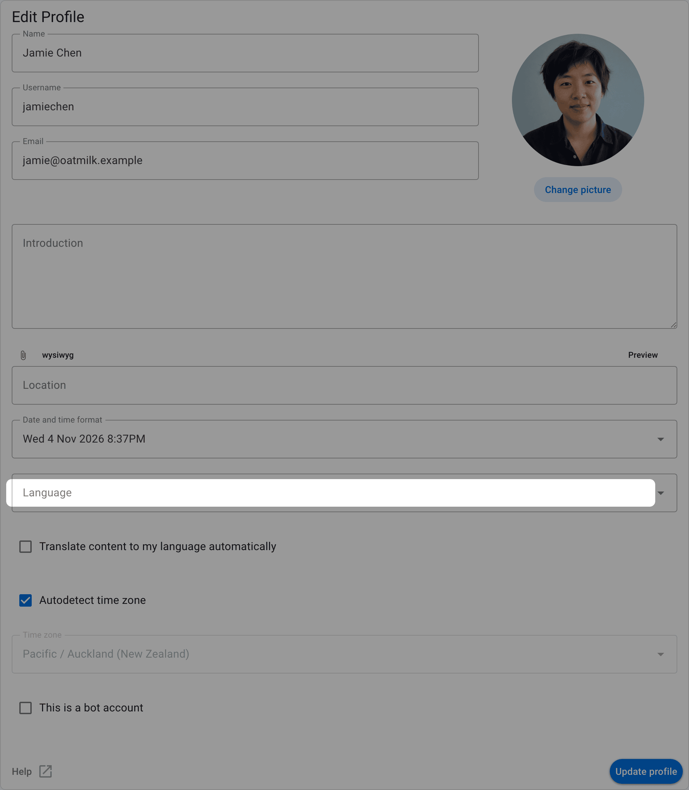
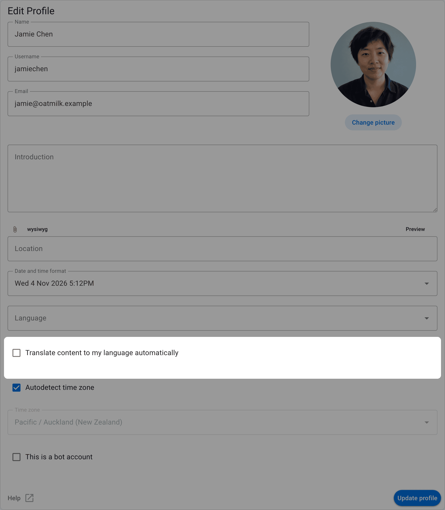

<!-- translation-section: introduction -->

# Languages and Translation

Change the language of Loomio's interface, or translate discussions, comments, and proposals into your preferred language.

<!-- translation-section: application-translation -->

## Application translation

Loomio detects your browser's preferred language. To choose a different language, open **Edit profile** and select one there.

<!-- translation-section: content-translation -->

## Content translation

When someone in your group writes a message in a language different from your preferred language, a **Translate** button appears below it. Select **Translate** to translate the message into your preferred language.

The translated text replaces the original text in the discussion. Select **original** to show the original text again.

Loomio uses Google Translate to translate content when you request it.

<!-- translation-section: automatic-translation -->

## Automatic translation

To translate discussions, comments, and proposals automatically, open **Edit profile** and turn on **Translate content to my language automatically**. Loomio translates content into the language selected in your profile.

