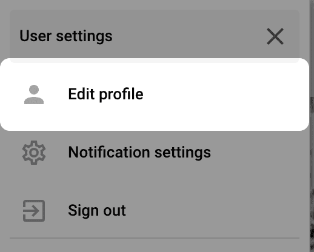
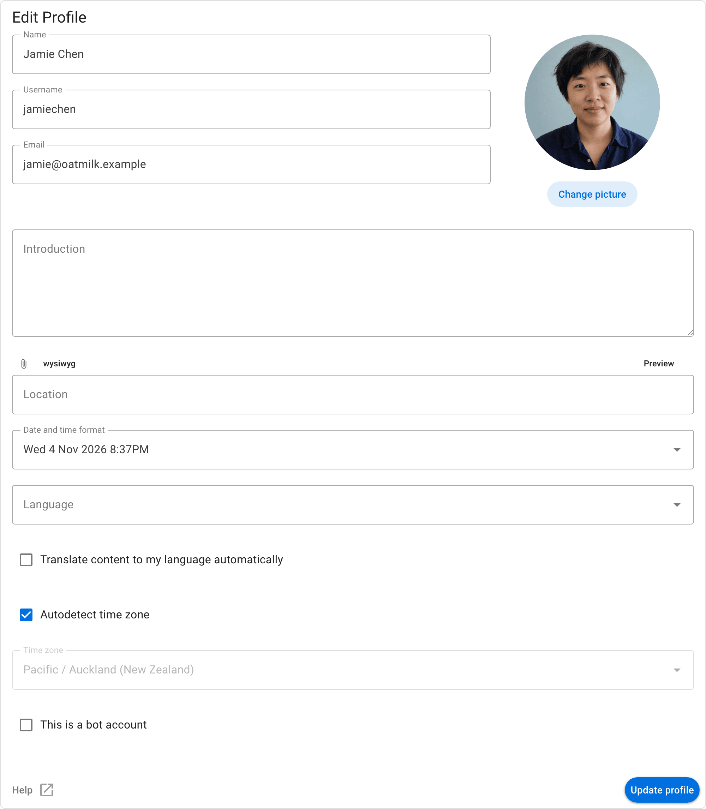
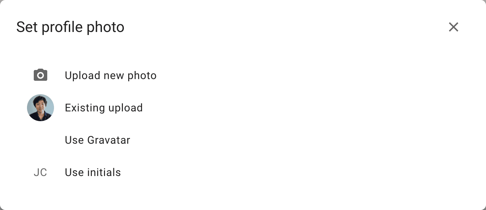

<!-- translation-section: introduction -->

# Your profile

Your profile helps people recognize you in Loomio. Add a photo, introduction, and other details you want to share.

<!-- translation-section: edit-profile -->

## Edit profile

Open your user menu by selecting your name in the sidebar, then select **Edit profile**. If the sidebar is closed, open it with the menu button (**☰**).

<!-- translation-section: update-your-personal-info -->

## Update your personal info

You can update any of these fields on your profile page:

- **Name**
- **Email address** — the address associated with your Loomio account, where Loomio sends your notifications.
- **Username** — the name people use to alert you with an `@mention`. It can contain lowercase letters, numbers, underscores, and internal hyphens.
- **Introduction** — a few lines to tell others in your group about yourself.
- **Location** — helpful for remote or distributed groups so people know where you are based.

<!-- translation-section: uploading-a-profile-photo -->

## Uploading a profile photo

When you create a Loomio account, your initials appear as your default profile picture. To upload a photo, select your picture on the profile page.

<!-- translation-section: language-settings -->

## Language

Loomio detects your browser's language by default, or you can select a preferred language on your profile page. For interface and content translation options, see [Languages and Translation](../translation).

<!-- translation-section: time-zone -->

## Time zone

Time poll options use the time zone saved in your profile. Enable **Autodetect time zone** to use your browser's time zone, or disable it, select your region under **Time zone**, and select **Update profile**.

<!-- translation-section: resetting-your-password -->

## Resetting your password

To change your password, open your profile page and select **Reset Password**.

<!-- translation-section: passkeys -->

## Passkeys

You can add, name, and remove passkeys on your profile page to sign in with your device's fingerprint, face recognition, PIN, or security key. See [Sign in with a passkey](../signing_in#sign-in-with-a-passkey).

<!-- translation-section: merge-accounts -->

## Merge accounts

If you have two Loomio accounts, you can combine them into one.

See [Merge accounts](../merge_accounts).

<!-- translation-section: deleting-your-account -->

## Deleting your account

To permanently delete your Loomio account and leave your groups, see [Deleting your Loomio account](../deleting_your_account).
