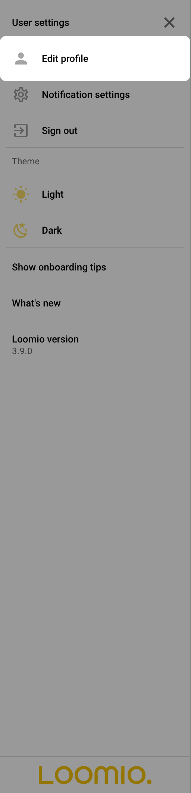
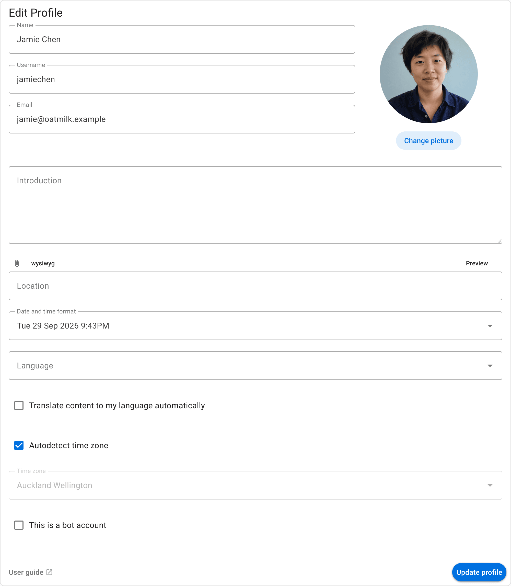
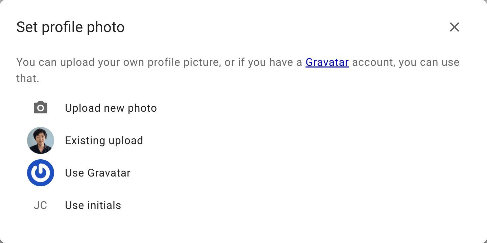

<!-- translation-section: introduction -->

# Your profile

Your profile helps people recognize you in Loomio. Add a photo, introduction and other details you want to share.

<!-- translation-section: edit-profile -->

## Edit profile

Open your user menu by selecting your name in the sidebar, then select **Edit profile**. If the sidebar is closed, open it with the menu button (**☰**).

<!-- translation-section: update-your-personal-info -->

## Update your personal info

You can update your personal info by changing any of the following fields:

* **Name**
* **Email address** - this is the email address associated with your Loomio account, and where you will receive notifications from Loomio.
* **Username** - your username is a name people can recognize and alert you using @mention. It can contain lower case letters, numbers, underscores, and internal hyphens.
* **Introduction** - a few lines to tell others in your group something about you.
* **Location** - useful for distributed or remote groups so people can get an idea of where you are located.

<!-- translation-section: viewing-another-person-s-profile -->

## Viewing another person's profile

Select a person's name or avatar to open their profile. Their recent discussions, comments, and polls are listed alongside their profile details and groups. The list only includes activity you have permission to access; signed-out visitors see public activity only.

<!-- translation-section: uploading-a-profile-photo -->

## Uploading a profile photo
When you first create a Loomio account, your initials will be the default image associated with your profile. You can upload a profile photo by clicking on your picture on the profile page. 

If you have a [Gravatar](https://en.gravatar.com/) you can set that as your profile picture by selecting **Use Gravatar**. You can also choose for Loomio to use the photo you use for other common platforms/tools.

<!-- translation-section: language-settings -->

## Language settings
Loomio is developed in English, but [is translated by volunteers into many languages](https://www.loomio.com/g/cpaM3Hsv/loomio-community-translation).

Loomio will detect your browser’s language settings, but you can manually set your preferred language from the available options on the profile page.

<!-- translation-section: resetting-your-password -->

## Resetting your password
You can change your password by visiting your profile page and clicking **Reset Password**.

<!-- translation-section: merge-accounts -->

## Merge accounts

If you have two Loomio user accounts, you can merge them into a single account.

See [Merge Accounts](../merge_accounts).

<!-- translation-section: deleting-your-account -->

## Deleting your account

If you wish to delete your Loomio user account and leave any Loomio groups you are a member of, see [Deleting Your Loomio Account](../deleting_your_account).
